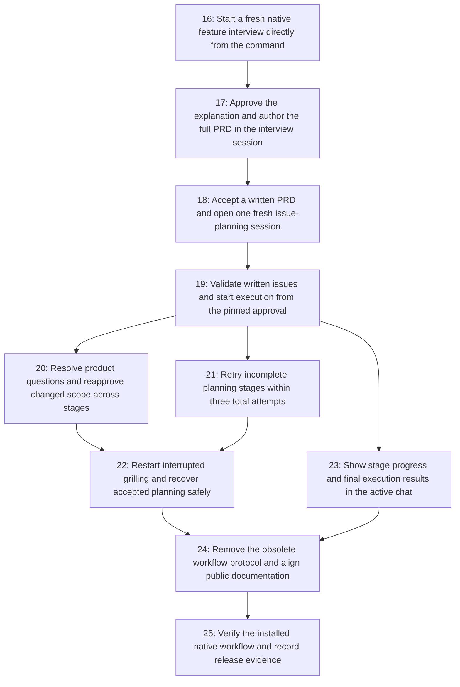

# Deterministic Ralph workflow implementation issues

Source: [PRD.md](../PRD.md), 2026-10-16. These tickets implement the replacement workflow. Previous tickets 1–15 were removed at the user’s request; the replacement tickets retain stable numbers 16–25. No GitHub issues were created.

The interview explicitly selected no breakdown-review gate; these local issues proceed from that approved choice. This index does not start implementation.

| Issue | Type | Blocked by | PRD user stories |
| --- | --- | --- | --- |
| [16. Start a fresh native feature interview directly from the command](issues/16-start-a-fresh-native-feature-interview.md) | AFK | None | 1, 2, 4 |
| [17. Approve the explanation and author the full PRD in the interview session](issues/17-approve-explanation-and-author-prd-in-place.md) | AFK | 16 | 3, 4, 5 |
| [18. Accept a written PRD and open one fresh issue-planning session](issues/18-complete-prd-and-open-fresh-issue-planning.md) | AFK | 17 | 4, 5 |
| [19. Validate written issues and start execution from the pinned approval](issues/19-complete-issues-and-start-authorized-execution.md) | AFK | 18 | 3, 5, 8 |
| [20. Resolve product questions and reapprove changed scope across stages](issues/20-reapprove-product-scope-changes-through-native-questions.md) | AFK | 19 | 2, 3, 6, 8 |
| [21. Retry incomplete planning stages within three total attempts](issues/21-bound-planning-attempts-and-reject-late-completions.md) | AFK | 19 | 5, 7 |
| [22. Restart interrupted grilling and recover accepted planning safely](issues/22-restart-grilling-and-recover-accepted-planning.md) | AFK | 20, 21 | 1, 7, 8 |
| [23. Show stage progress and final execution results in the active chat](issues/23-show-stage-and-execution-progress-in-active-chat.md) | AFK | 19 | 5, 7, 8 |
| [24. Remove the obsolete workflow protocol and align public documentation](issues/24-remove-obsolete-chat-workflow-protocol.md) | AFK | 22, 23 | 1, 3, 5, 7 |
| [25. Verify the installed native workflow and record release evidence](issues/25-verify-installed-native-workflow-and-release-evidence.md) | HITL | 24 | 1–8 |

## Dependency graph

## Sequencing and completion

16 → 17 → 18 → 19 establishes a demoable command-to-execution path. After 19, scope decisions (20), planning retries (21), and visibility (23) can proceed as separate slices. Recovery (22) follows 20 and 21. Legacy removal (24) follows recovery and visibility. Installed-package and human-visible validation (25) closes the set. Build/browser/package/test commands still run sequentially within any shared checkout.

All slices are AFK except 25, whose live native-form/navigation verification is HITL. Automated package and host tests remain part of 25 and should run before requesting human trial evidence.

Every slice owns its tests and compact wiki update. Issue 25 consolidates installed-host/platform evidence; it is not a substitute for per-slice public-interface tests or mandatory full integration checks.
